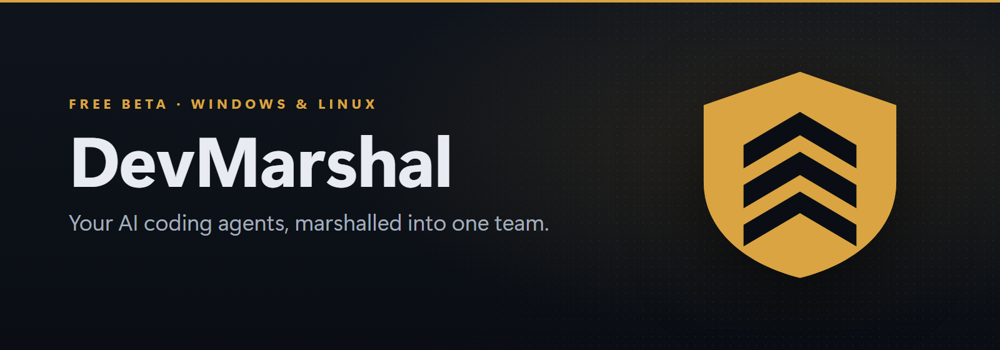
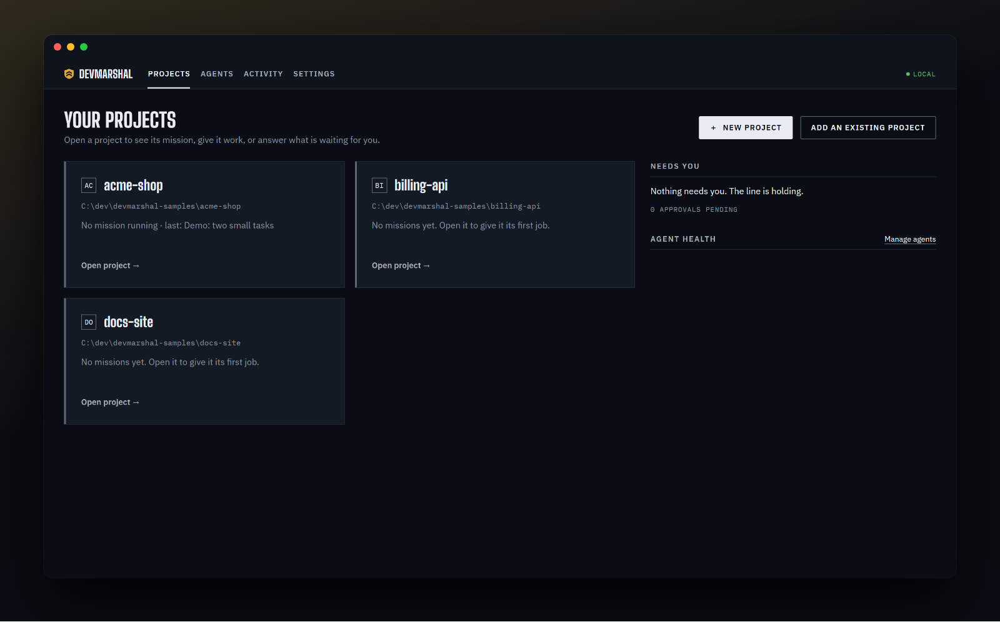
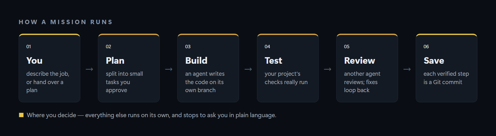
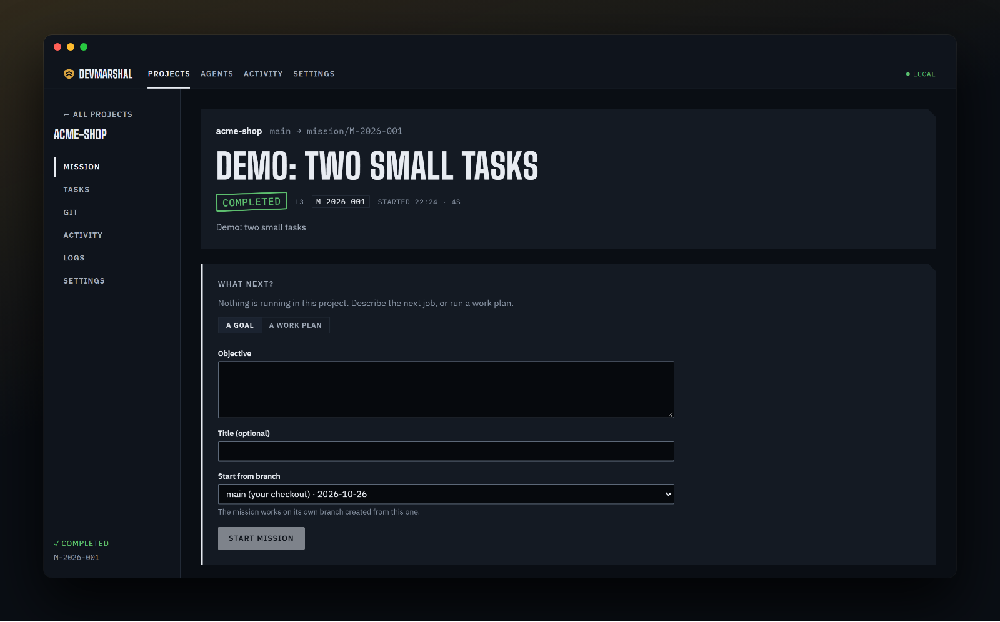
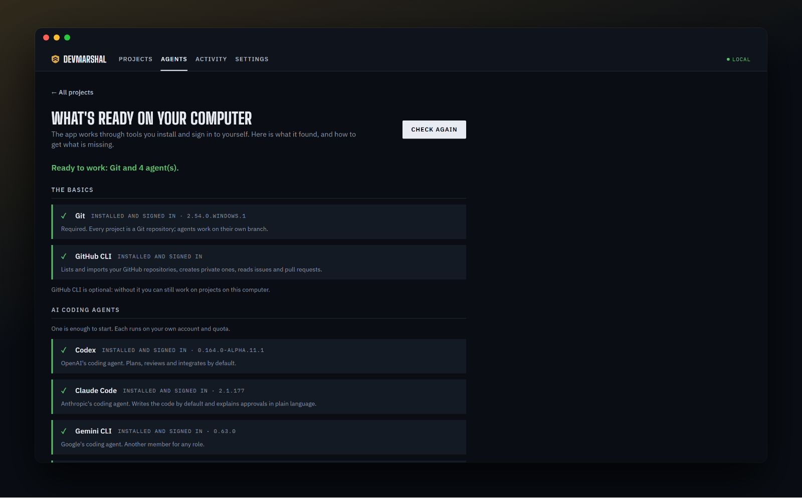
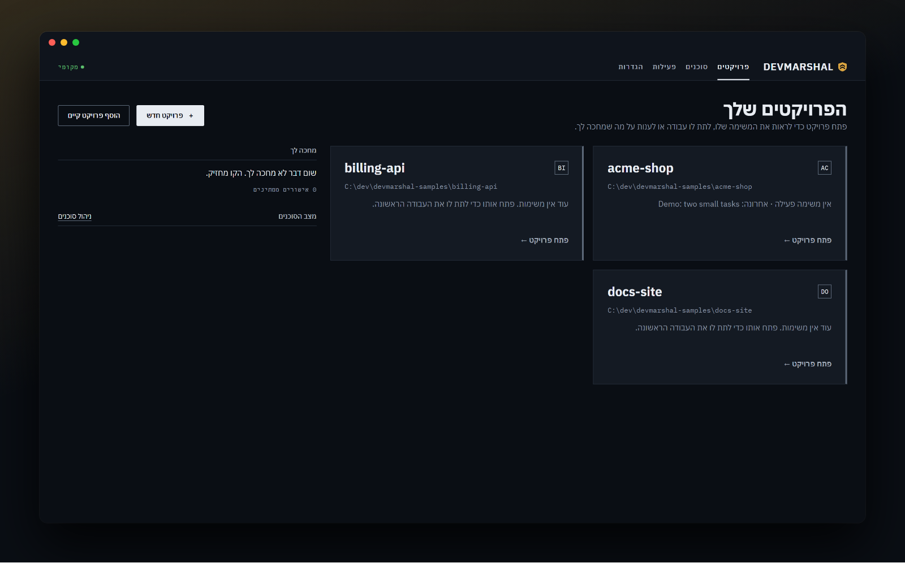

  

  
  
  
  

<h3 align="center">
  Stop copy-pasting between AI tools. 
  DevMarshal makes Claude Code, Codex, Gemini CLI and Ollama work as <i>one</i> engineering team on your project.
</h3>

  <a href="https://github.com/MBdeveleopmentS/devmarshal/releases/latest"><b>⬇&nbsp;&nbsp;Download for Windows</b></a>
  &nbsp;&nbsp;·&nbsp;&nbsp;
  <a href="#-install"><b>🐧&nbsp;&nbsp;Linux</b></a>
  &nbsp;&nbsp;·&nbsp;&nbsp;
  <a href="#-in-hebrew--בעברית"><b>🇮🇱&nbsp;&nbsp;בעברית</b></a>

 

## ✦ Why DevMarshal

<table>
<tr>
<td width="33%" valign="top">

### 🧭 A team, not a chat
One agent **plans**, another **writes the code**, your project's tests **really run**, and a third agent **reviews**. Fixes loop back on their own. You stop being the messenger between tools.

</td>
<td width="33%" valign="top">

### ✋ You decide what matters
Work runs by itself and stops only when a decision is yours. Every question comes **in plain language** — what happened, why you are asked, and what each choice will do.

</td>
<td width="33%" valign="top">

### 🔒 Your code stays yours
Everything runs **on your computer**, with the AI tools and accounts you already have. Agents work on their own Git branch; **your checkout is never touched**. No telemetry.

</td>
</tr>
</table>

## ⚙ How it works

- **Give it a goal** ("add a password reset") **or a whole plan file** — it splits the work into small tasks for you to approve.
- **Each task** is written by one agent, checked by your project's real tests, and reviewed by another agent before it is saved as a Git commit.
- **Something needs you?** It waits, tells you why in plain words, and carries on after your answer. If the app or the computer restarts mid-mission, it recovers safely and shows what it found.
- **Large plans** can land part by part as pull requests on GitHub.

## 📸 A closer look

<table>
<tr>
<td width="50%"> <b>A mission</b> — progress, the next step, and what to do next.</td>
<td width="50%"> <b>Ready check</b> — finds your tools by itself and shows how to install what is missing.</td>
</tr>
<tr>
<td width="50%"> <b>English or Hebrew</b> — the whole app, right-to-left included.</td>
<td width="50%" valign="middle">

**Also inside**
- Its own window, startup screen and installer
- Any agent can take any role, with a backup agent when one runs out of quota
- Import from this computer or from GitHub, or start a new project from a plan
- A daily "new version available" notice (can be turned off)

</td>
</tr>
</table>

## ⬇ Install

| | Download | Steps |
|---|---|---|
|  | `devmarshal-<version>-setup.exe` | Run it — no administrator rights needed. Windows SmartScreen may warn because the installer is not signed: **More info → Run anyway**. |
|  | `devmarshal-<version>-linux-x64.tar.gz` | `tar -xzf devmarshal-*.tar.gz && cd devmarshal-* && ./install.sh` — then open it from your applications menu. |

👉 **[Get the latest release](https://github.com/MBdeveleopmentS/devmarshal/releases/latest)** · verify your download with `SHA256SUMS.txt`.

### What you need

| | |
|---|---|
| **[Git](https://git-scm.com/downloads)** | Required. |
| **At least one AI coding tool**, installed and signed in | [Claude Code](https://docs.claude.com/en/docs/claude-code/setup) · [Codex](https://github.com/openai/codex) · [Gemini CLI](https://github.com/google-gemini/gemini-cli) · [Ollama](https://ollama.com/download) (free, runs locally) |
| [GitHub CLI](https://cli.github.com/) | Optional — for importing your GitHub repositories and pull requests. |

Not sure what you have? DevMarshal checks on first start and shows **exactly what is missing and the command to install it**.

## ❓ Questions

<b>Is it really free?</b>
 
Yes. DevMarshal is free to use, including for work. The AI tools it runs are your own: their usage counts against <i>your</i> accounts and plans with those providers.

<b>Does my code leave my computer?</b>
 
DevMarshal itself sends nothing anywhere — no telemetry, no account. The AI tools you choose talk to their own providers, exactly as when you use them directly. With Ollama, everything stays local.

<b>Can it break my project?</b>
 
Agents work in a separate Git worktree on their own branch; your own checkout is not modified. Each verified step is a commit you can inspect or undo, and destructive Git operations never run without your explicit approval. It is a beta: keep backups.

<b>Windows says the installer is unrecognised.</b>
 
The installer is not code-signed, so SmartScreen shows a warning the first time. Choose <i>More info → Run anyway</i>. Check the file against <code>SHA256SUMS.txt</code> from the release if you want to be sure it is the original.

<b>Mac?</b>
 
Not yet. Windows and Linux are supported today.

## 🇮🇱 In Hebrew · בעברית

**DevMarshal** מפעיל את כלי הקוד מבוססי ה-AI שכבר יש לך — Claude Code, ‏Codex, ‏Gemini CLI או מודל מקומי וחינמי דרך Ollama — **כצוות פיתוח אחד** על הפרויקטים שלך.

- **מתכנן, כותב, בודק וסוקר:** סוכן אחד מתכנן, אחר כותב את הקוד, הבדיקות של הפרויקט רצות באמת, וסוכן שלישי סוקר. מה שלא עובר חוזר לתיקון לבד.
- **פונה אליך רק כשההחלטה שלך**, ובעברית פשוטה: מה קרה, למה שואלים אותך, ומה יקרה בכל בחירה.
- **הכול רץ אצלך במחשב**, עם החשבונות שלך. הסוכנים עובדים על ענף משלהם, והתיקייה שלך לא נפגעת.
- **התוכנה כולה בעברית**, כולל המתקין.

**להורדה:** [הגרסה האחרונה](https://github.com/MBdeveleopmentS/devmarshal/releases/latest), למחשבי Windows ו-Linux. בהפעלה הראשונה התוכנה בודקת מה מותקן אצלך ומראה בדיוק מה חסר ואיך להתקין אותו.

## 🛡 Security

Found a security problem? Please report it **privately** — see [SECURITY.md](SECURITY.md).

## 📄 Licence

DevMarshal is **freeware**: free to use, closed source — see [LICENSE.txt](LICENSE.txt). This repository holds the releases and this page only.

 

 DevMarshal · © 2026 The DevMarshal authors

